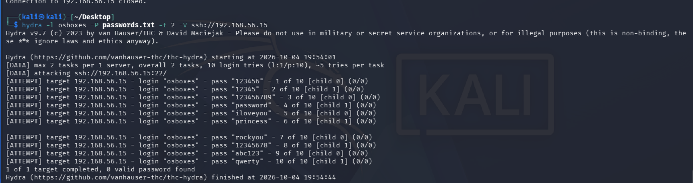
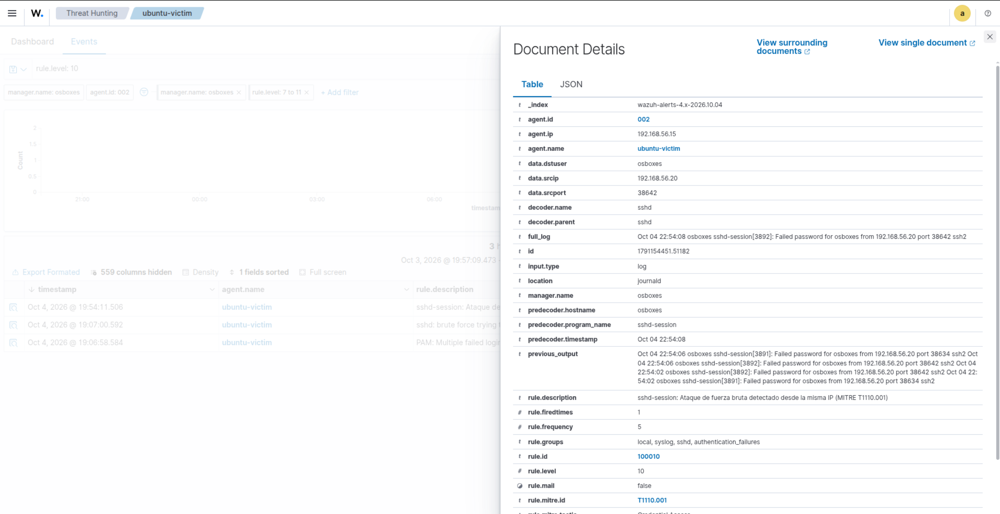
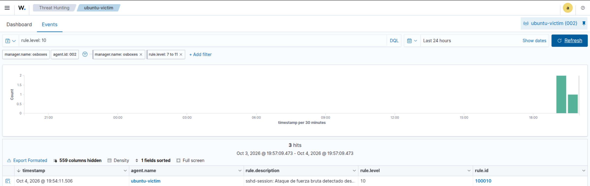
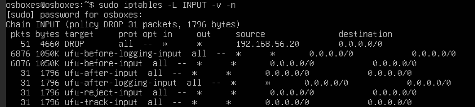

## Resumen del Proyecto

Laboratorio integral de ciberseguridad enfocado en la **emulación de adversarios** (Red Team), **ingeniería de detección** (*Detection-as-Code*) y análisis en **SIEM/EDR** (Blue Team) mapeado a la matriz **MITRE ATT&CK**.

El objetivo del proyecto es reproducir técnicas reales de intrusión en un entorno controlado, analizar la telemetría generada en endpoints Windows y Linux, y construir reglas de detección precisas (Sigma / Wazuh) junto con playbooks de respuesta a incidentes bajo estándar NIST SP 800-61 / SANS.

---

## Topología de Red Dual-NIC

El laboratorio se encuentra desplegado en un hipervisor **VirtualBox** utilizando una arquitectura aislada de dos interfaces por máquina para separar la gestión externa del tráfico de ataque y telemetría:

- **Adaptador 1 (NAT):** Conectividad a internet para paquetes y actualizaciones.
- **Adaptador 2 (Host-Only `vboxnet0`):** Subred privada `192.168.56.0/24` dedicada exclusivamente al tráfico de emulación, telemetría e ingesta de logs.

<div class="lab-topology" role="group" aria-label="Topología del laboratorio en la subred aislada 192.168.56.0/24">
<p class="topology-label">VIRTUALBOX / HOST-ONLY / 192.168.56.0/24 · HOST DE CONTROL: 192.168.56.1</p>
<div class="topology-grid">
<div class="topology-node offensive"><span>EMULACIÓN</span><strong>Kali Linux</strong><code>192.168.56.20</code><small>Hydra · Nmap · Metasploit</small></div>
<div class="topology-node"><span>ENDPOINT WINDOWS</span><strong>Windows 11 Pro</strong><code>192.168.56.10</code><small>Sysmon · ScriptBlock Logging</small></div>
<div class="topology-node"><span>ENDPOINT LINUX</span><strong>Ubuntu Server</strong><code>192.168.56.15</code><small>OpenSSH · Web App</small></div>
<div class="topology-node defensive"><span>DETECCIÓN Y RESPUESTA</span><strong>Wazuh 4.x</strong><code>192.168.56.30</code><small>Indexer · Manager · Dashboard</small></div>
</div>
<p class="topology-path">Emulación de ataques <span aria-hidden="true">→</span> Telemetría de endpoints <span aria-hidden="true">→</span> SIEM <span aria-hidden="true">→</span> Contención en Linux</p>
</div>

| Nodo | Sistema Operativo | IP Lab (`vboxnet0`) | Función |
| :--- | :--- | :--- | :--- |
| **SOC SIEM** | Ubuntu Server 24.04 | `192.168.56.30` | Ingesta de logs, correlación y Active Response |
| **Endpoint Windows** | Windows 11 Pro | `192.168.56.10` | Telemetría Sysmon y PowerShell ScriptBlock |
| **Servidor Linux** | Ubuntu Server 24.04 | `192.168.56.15` | Servicios SSH y aplicaciones emuladas |
| **Atacante** | Kali Linux | `192.168.56.20` | Emulación de adversarios controlada |

---

## Caso de Estudio 1: Ataque de Fuerza Bruta SSH (MITRE T1110.001)

### 1. Fase Ofensiva (Red Team)
Desde la máquina Kali Linux (`192.168.56.20`), se realizó un reconocimiento con `nmap` y posterior ataque de fuerza bruta sobre el servicio OpenSSH del servidor Linux (`192.168.56.15`) utilizando **Hydra**:

```bash
hydra -l osboxes -P /usr/share/wordlists/rockyou.txt ssh://192.168.56.15 -t 4
```

### 2. Detección & Telemetría (Blue Team)
En Ubuntu 24.04, los intentos fallidos de autenticación SSH son gestionados por el binario `sshd-session` en lugar del demonio clásico `sshd`. Se identificaron los logs de evento:
* `Failed password for osboxes from 192.168.56.20 port ... ssh2`

Se implementó una **regla Sigma** nativa y una **regla personalizada en Wazuh** (`local_rules.xml`, Regla 100010):

```xml
<group name="syslog,sshd,sshd-session,">
  <rule id="100010" level="10" frequency="6" timeframe="120">
    <if_matched_sid>5716</if_matched_sid>
    <same_source_ip />
    <description>Posible ataque de fuerza bruta SSH (múltiples fallos de autenticación sshd-session desde $(srcip)).</description>
    <mitre>
      <id>T1110.001</id>
      <id>T1110</id>
    </mitre>
    <group>authentication_failures,pci_dss_10.2.4,pci_dss_10.2.5,</group>
  </rule>
</group>
```

### 3. Contención Automatizada (Active Response)
Al alcanzarse el umbral de 6 intentos fallidos en 120 segundos, Wazuh dispara automáticamente un comando **Active Response** (`firewall-drop`) en el agente víctima, insertando una regla dinámica en `iptables`:

```bash
iptables -I INPUT -s 192.168.56.20 -j DROP
```

La IP atacante queda inmediatamente aislada por el tiempo configurado, cortando la conexión TCP en curso y mitigando la intrusión en tiempo real.

---

## Evidencias Técnicas & Dashboard

<div class="evidence-grid" markdown="1">

<figure class="evidence-card" markdown="1">

[{ loading=lazy }](../assets/purple-team-soc-lab/01_hydra_attack_kali.png)

<figcaption><span>01 / EMULACIÓN</span><strong>Ataque Hydra en Kali Linux</strong><small>Abrir captura a tamaño completo ↗</small></figcaption>
</figure>

<figure class="evidence-card" markdown="1">

[{ loading=lazy }](../assets/purple-team-soc-lab/02_wazuh_custom_rule_100010.png)

<figcaption><span>02 / DETECCIÓN</span><strong>Regla 100010 en Wazuh SIEM</strong><small>Abrir captura a tamaño completo ↗</small></figcaption>
</figure>

<figure class="evidence-card" markdown="1">

[{ loading=lazy }](../assets/purple-team-soc-lab/03_wazuh_level10_dashboard.png)

<figcaption><span>03 / CORRELACIÓN</span><strong>Eventos críticos de nivel 10</strong><small>Abrir captura a tamaño completo ↗</small></figcaption>
</figure>

<figure class="evidence-card" markdown="1">

[{ loading=lazy }](../assets/purple-team-soc-lab/05_iptables_firewall_drop.png)

<figcaption><span>04 / CONTENCIÓN</span><strong>Bloqueo dinámico del atacante</strong><small>Abrir captura a tamaño completo ↗</small></figcaption>
</figure>

</div>

---

## Repositorio del Proyecto
El código fuente de las reglas Sigma, configuración de Wazuh y los Playbooks de Respuesta a Incidentes (SOPs) se encuentran en GitHub:
**[github.com/Jusnock/purple-team-soc-lab](https://github.com/Jusnock/purple-team-soc-lab)**
